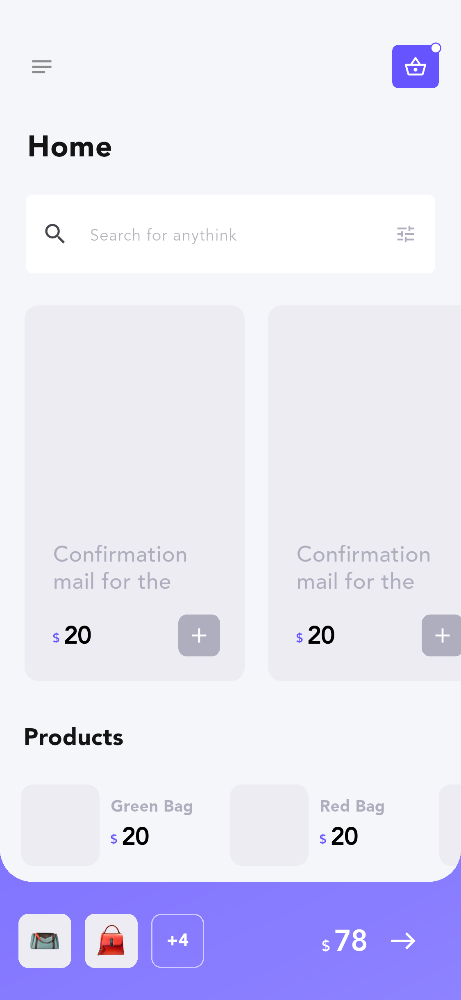
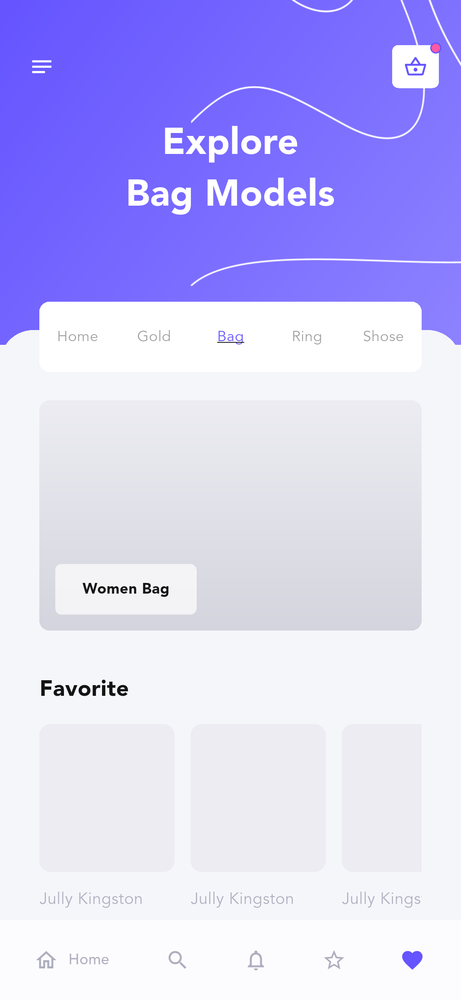
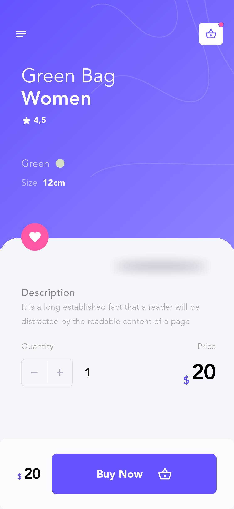
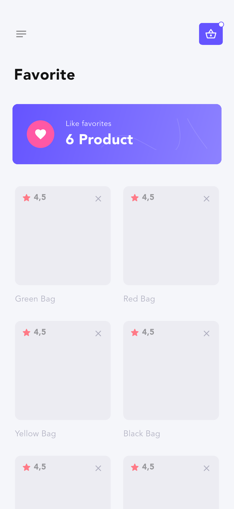
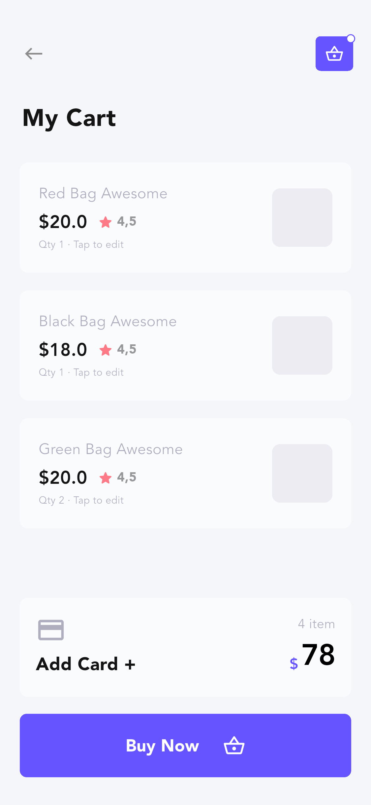
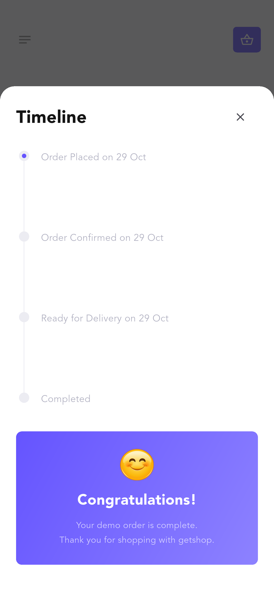

# Getshop Flutter App

根据 Pixso **Getshop Ui Template → Page 1** 实现的购物 App。已读取该文件全部 **21 个顶层界面**，覆盖引导、登录注册、菜单、商品浏览、排序筛选、收藏、三种商品详情、购物车、添加卡片、商品展示和订单进度。

采用 Flutter 原生控件实现，保留原稿的紫色渐变、浅灰背景、粉色强调色及 Avenir 字体。插画、头像、缩略图与菜单中的倾斜预览图来自原设计。

## 主要界面

以下为 **Android 模拟器实际运行截图**。完整 21 页截图、原稿及对应关系见 [截图索引](docs/SCREENSHOTS.md)。

| 首页 | 分类探索 | 商品详情 |
| --- | --- | --- |
|  |  |  |

| 收藏 | 购物车 | 订单完成 |
| --- | --- | --- |
|  |  |  |

## 运行与安装

验证环境：Flutter **3.41.6**、Dart **3.11.4**、Android **API 35** / ARM64 模拟器。工程包含 Android、iOS 和 Web 入口。

```bash
flutter pub get
flutter run
```

可直接安装 [Android ARM64 预览包](dist/getshop-android-arm64.apk)，约 18 MB。该包采用演示签名，正式发布时需配置自己的签名。

```bash
adb install -r dist/getshop-android-arm64.apk

# 直接查看某一页面
flutter run --dart-define=SCREEN=home
flutter run --dart-define=SCREEN=productGreen
flutter run --dart-define=SCREEN=filter

# 浏览器运行
flutter run -d chrome
```

`SCREEN` 完整可选值见 [截图索引](docs/SCREENSHOTS.md)，默认从欢迎页开始。

## 已完成的交互

- 引导前进、登录注册切换、必填及邮箱/密码校验、显示隐藏密码、演示头像切换。
- 菜单导航，查看本地个人资料、设置和帮助，退出演示登录。
- 首页搜索、横向商品列表、详情跳转、分类标签切换。
- 排序、价格/分类/颜色筛选，展开收起、清空和应用；尺寸选择保留在筛选状态中。
- 收藏与取消收藏，收藏数实时更新。
- 商品颜色切换、数量调整、加购；购物车数量及金额联动，点击条目编辑数量、左滑删除。
- 添加演示卡片、表单校验、返回购物车结算，展示订单完成并清空购物车。

体验路径：欢迎 → 引导 → 登录/注册 → 确认 → 首页 → 菜单 Product → 商品分类 → 详情 → 购物车 → 添加卡片 → Buy Now → Timeline。

登录可使用任意非空用户名及至少 6 位密码。演示卡号：`4242424242424242`，有效期选择未来年月，CVC 输入 3–4 位数字。

## 项目结构

```text
Getshop/
├── lib/
│   ├── main.dart                       # 启动、显示模式、初始页面
│   └── src/
│       ├── app.dart                    # 应用入口、页面分发、系统返回
│       ├── theme.dart                  # 颜色、字体、表单主题
│       ├── models/product.dart         # 商品模型和演示数据
│       ├── state/shop_controller.dart  # 导航、购物车、收藏、筛选、会话
│       ├── widgets/shop_widgets.dart   # 按钮、页头、卡片、评分、价格等
│       └── screens/
│           ├── onboarding_screen.dart  # 欢迎、引导、邮件确认
│           ├── auth_screen.dart        # 登录与注册
│           ├── menu_screen.dart        # 菜单
│           ├── catalog_screen.dart     # 首页、探索、分类、收藏
│           ├── filter_screen.dart      # 排序、折叠/展开筛选
│           ├── product_screen.dart     # 三种详情、商品展示
│           └── checkout_screen.dart    # 购物车、添加卡片、订单进度
├── assets/images/                      # Pixso 独立插画和装饰素材
├── assets/fonts/                       # Avenir 字体
├── test/                               # 状态、截图、适配、交互测试
├── integration_test/app_test.dart      # Android 全页截图和购物流程
├── test_driver/integration_test.dart   # 保存模拟器截图
├── tool/verify.sh                      # 一键验证
├── docs/
│   ├── SCREENSHOTS.md                  # 全界面截图索引
│   ├── VERIFICATION.md                 # 验证记录
│   ├── design-map.json                 # Pixso 节点与页面映射
│   ├── reference/                      # 21 张原稿
│   └── screenshots/                    # 渲染图及 Android 实际截图
├── dist/getshop-android-arm64.apk       # Android 演示包
├── android/ ios/ web/                  # 平台工程
└── pubspec.yaml
```

## 架构说明

采用 **界面层 → 状态控制器 → 数据模型** 的轻量结构。`ShopController` 继承 `ChangeNotifier`，由 `GetshopApp` 的 `AnimatedBuilder` 订阅。搜索、收藏、购物车、筛选和会话集中管理；表单输入及筛选草稿由页面自己的 StatefulWidget 管理。

`AppScreen` 定义 21 个设计状态与 Pixso 节点 ID，控制器维护页面历史，统一处理前进和返回。金额、数量从购物车条目推导，避免多个页面维护不一致的总价。商品变体、登录注册、分类收藏共用布局与组件。

业务运行仅使用 Flutter SDK 和平台图标包，没有额外的状态管理、路由或网络框架。输入控制器随页面销毁释放；素材打包在本地，运行时不依赖 Pixso 或临时导出地址。

## 设计数据与演示范围

当前为可运行的 **本地 UI 演示工程**。商品、登录身份、收藏、购物车和卡片尾号保存在当前内存会话中，重启后恢复演示数据。尚未接入服务端、真实邮件、OAuth、支付或物流；尺寸暂无库存规则。

原稿金额、数量和收藏数存在不一致，本实现采用可计算的数据：初始购物车 4 件共 **$78**、收藏 6 件，后续随操作更新。注册页重复的 Email 文案调整为邮箱、密码和确认密码；卡片有效期明确为月/年。

多个原始画板中的主商品图片为空，仅缩略图和菜单预览含商品图。本实现保留原稿留白；原稿截图单独保存在 `docs/reference/`，便于逐页核对。

## 验证与代码精简

已通过静态分析、**27 项单元/界面测试**、320 和 430 逻辑像素宽度检查，以及 Android 模拟器完整购物流程。Android Release APK 与 Web 均已构建。iOS 工程已生成，本机未安装 iOS Simulator runtime，尚未进行 iOS 运行验证。详见 [验证记录](docs/VERIFICATION.md)。

交付前已移除临时导出代码和清单，复用按钮、页头、商品卡片、价格、评分、数量及横幅组件；重复设计状态通过参数与数据驱动实现。测试和来源截图保留用于维护验收。

```bash
./tool/verify.sh

# 启动模拟器后执行集成测试并刷新实际截图
DEVICE_ID=emulator-5554 ./tool/verify.sh

# 有意修改界面后更新截图基线
flutter test --update-goldens
```

原设计素材和 Avenir 字体用于本地还原，正式分发前需按实际授权确认使用权或替换。
