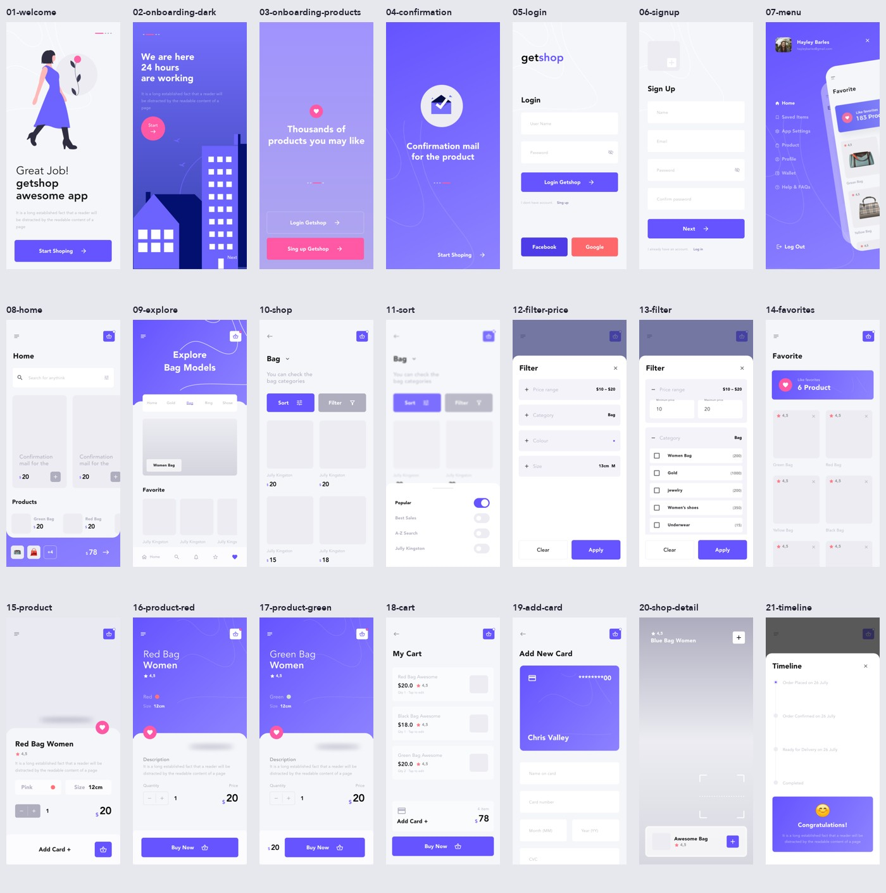

# 全部界面截图与 Pixso 对应关系

来源：**Getshop Ui Template → Page 1（0:1）**，共 21 个顶层界面。

- **模拟器截图**：Android API 35，1125 × 2436，真实运行视口；较长页面可滚动。
- **原稿尺寸渲染图**：Flutter 测试引擎生成，375 像素宽，按对应画板高度保存，便于检查完整长页。
- **Pixso 原稿**：直接导出的设计参考，区别于 App 截图。

| # | 界面 | SCREEN 参数 | Pixso 节点 | 模拟器截图 | 原稿尺寸渲染图 | Pixso 原稿 |
| --- | --- | --- | --- | --- | --- | --- |
| 1 | 欢迎页 | `welcome` | `1:465` | [查看](screenshots/android/01-welcome.png) | [查看](screenshots/01-welcome.png) | [查看](reference/01-welcome.png) |
| 2 | 夜间引导 | `onboardingDark` | `1:400` | [查看](screenshots/android/02-onboarding-dark.png) | [查看](screenshots/02-onboarding-dark.png) | [查看](reference/02-onboarding-dark.png) |
| 3 | 商品引导 | `onboardingProducts` | `1:51` | [查看](screenshots/android/03-onboarding-products.png) | [查看](screenshots/03-onboarding-products.png) | [查看](reference/03-onboarding-products.png) |
| 4 | 邮件确认 | `confirmation` | `1:270` | [查看](screenshots/android/04-confirmation.png) | [查看](screenshots/04-confirmation.png) | [查看](reference/04-confirmation.png) |
| 5 | 登录 | `login` | `1:505` | [查看](screenshots/android/05-login.png) | [查看](screenshots/05-login.png) | [查看](reference/05-login.png) |
| 6 | 注册 | `signup` | `1:565` | [查看](screenshots/android/06-signup.png) | [查看](screenshots/06-signup.png) | [查看](reference/06-signup.png) |
| 7 | 侧边菜单 | `menu` | `1:338` | [查看](screenshots/android/07-menu.png) | [查看](screenshots/07-menu.png) | [查看](reference/07-menu.png) |
| 8 | 首页 | `home` | `1:994` | [查看](screenshots/android/08-home.png) | [查看](screenshots/08-home.png) | [查看](reference/08-home.png) |
| 9 | 分类探索 | `explore` | `1:625` | [查看](screenshots/android/09-explore.png) | [查看](screenshots/09-explore.png) | [查看](reference/09-explore.png) |
| 10 | 商品分类 | `shop` | `1:922` | [查看](screenshots/android/10-shop.png) | [查看](screenshots/10-shop.png) | [查看](reference/10-shop.png) |
| 11 | 排序 | `sort` | `1:2` | [查看](screenshots/android/11-sort.png) | [查看](screenshots/11-sort.png) | [查看](reference/11-sort.png) |
| 12 | 筛选（折叠） | `filterPrice` | `1:771` | [查看](screenshots/android/12-filter-price.png) | [查看](screenshots/12-filter-price.png) | [查看](reference/12-filter-price.png) |
| 13 | 筛选（展开） | `filter` | `1:823` | [查看](screenshots/android/13-filter.png) | [查看](screenshots/13-filter.png) | [查看](reference/13-filter.png) |
| 14 | 收藏 | `favorites` | `1:1077` | [查看](screenshots/android/14-favorites.png) | [查看](screenshots/14-favorites.png) | [查看](reference/14-favorites.png) |
| 15 | 商品详情（浅色） | `product` | `1:84` | [查看](screenshots/android/15-product.png) | [查看](screenshots/15-product.png) | [查看](reference/15-product.png) |
| 16 | 商品详情（红色） | `productRed` | `1:144` | [查看](screenshots/android/16-product-red.png) | [查看](screenshots/16-product-red.png) | [查看](reference/16-product-red.png) |
| 17 | 商品详情（绿色） | `productGreen` | `1:213` | [查看](screenshots/android/17-product-green.png) | [查看](screenshots/17-product-green.png) | [查看](reference/17-product-green.png) |
| 18 | 购物车 | `cart` | `1:1154` | [查看](screenshots/android/18-cart.png) | [查看](screenshots/18-cart.png) | [查看](reference/18-cart.png) |
| 19 | 添加卡片 | `addCard` | `1:1204` | [查看](screenshots/android/19-add-card.png) | [查看](screenshots/19-add-card.png) | [查看](reference/19-add-card.png) |
| 20 | 商品展示 | `shopDetail` | `1:17` | [查看](screenshots/android/20-shop-detail.png) | [查看](screenshots/20-shop-detail.png) | [查看](reference/20-shop-detail.png) |
| 21 | 订单进度 | `timeline` | `1:715` | [查看](screenshots/android/21-timeline.png) | [查看](screenshots/21-timeline.png) | [查看](reference/21-timeline.png) |

额外准备了 [完整购物流程结束截图](screenshots/android/22-checkout-complete.png)。

普通 Release 安装包已在模拟器冷启动通过，另存 [Release 欢迎页截图](screenshots/android/23-release-welcome.png)。

长页可对照 [展开筛选完整渲染图](screenshots/13-filter.png)、[商品分类完整渲染图](screenshots/10-shop.png) 与 [添加卡片完整渲染图](screenshots/19-add-card.png)。

## 全页预览

